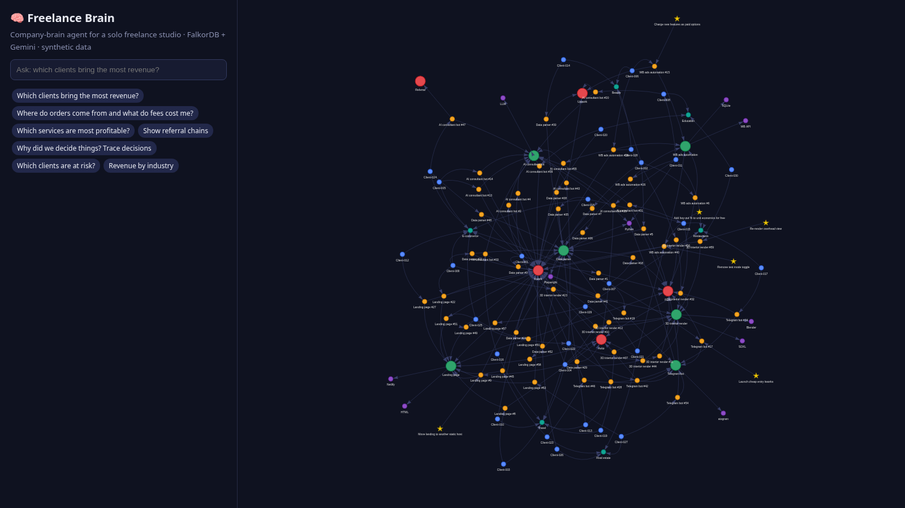

# 🧠 Freelance Brain — a company-brain agent on FalkorDB

**Graph Hacks 2026 · Track 03: Company Brain** (also relevant to Track 01: agents that act on connected data)

A solo freelancer is a one-person company: clients, orders, platforms (Kwork, FL.ru, Avito, Upwork, referrals),
services, skills, chat messages, payments and *decisions* all live in different tabs. Freelance Brain puts them
into one FalkorDB graph and gives you an agent that answers business questions in plain English —
and shows exactly which Cypher it ran and which nodes the answer came from.

> All data is **synthetic** and generated deterministically (`app/seed.py`). No real clients, names or keys.



## What it does
- "Which clients bring the most revenue?" → LTV ranking from `Client→Order→Payment`
- "Where do orders come from and what do fees cost me?" → platform mix, gross vs net, fees lost
- "Show referral chains" → multi-hop `REFERRED*1..3` traversal + revenue the referrals produced
- "Why did we decide X?" → **decision provenance**: `Decision→BASED_ON→Message←SENT←Client`, `Decision→AFFECTS→Order`
- Anything else → Gemini writes read-only openCypher from the schema; if FalkorDB rejects it, the error is fed back once for self-repair

## Architecture
```
Browser (vis-network graph + chat)
   │  /api/ask
Flask ──► Agent ──► Planner (Gemini): pick curated tool OR generate Cypher
   │                 │ read-only guard (regex + GRAPH.RO_QUERY, 5s timeout)
   │                 ▼
   │            FalkorDB (server via Docker, or embedded falkordblite)
   ▼                 │ rows
Answer (Gemini summary) + Cypher + rows + trace + highlighted nodes
```
Without an API key (or if the LLM is rate-limited/down) the agent degrades to deterministic keyword routing over
curated tools, so the demo never breaks. Gemini model fallback chain is configurable via `GEMINI_MODELS`.

## Graph data model
| Node | Properties |
|---|---|
| Client | id, name, since |
| Order | id, title, price, status (done/in_progress/cancelled), created |
| Payment | id, amount, net (after platform fee), paid |
| Platform | id, name, fee_pct |
| Service | id, name, base_price |
| Skill, Industry | id, name |
| Message | id, topic, sentiment, text, at |
| Decision | id, title, rationale, at |

```
(Client)-[:PLACED]->(Order)-[:FOR_SERVICE]->(Service)-[:REQUIRES]->(Skill)
(Order)-[:VIA]->(Platform)        (Order)-[:PAID_BY]->(Payment)
(Client)-[:SENT]->(Message)-[:ABOUT]->(Order)
(Client)-[:IN_INDUSTRY]->(Industry)   (Client)-[:REFERRED]->(Client)
(Decision)-[:BASED_ON]->(Message)     (Decision)-[:AFFECTS]->(Order)
```
Seed size: 30 clients, ~60 orders, ~150 messages, 6 decisions.

## Cypher the product depends on
All in `app/agent.py` → `TOOLS`. Examples:
```cypher
// Lifetime value
MATCH (c:Client)-[:PLACED]->(o:Order)-[:PAID_BY]->(p:Payment)
RETURN c.name, count(o), sum(p.net) AS net ORDER BY net DESC LIMIT 10
// Referral chains (multi-hop)
MATCH path=(a:Client)-[:REFERRED*1..3]->(b:Client)
OPTIONAL MATCH (b)-[:PLACED]->(:Order)-[:PAID_BY]->(p:Payment)
RETURN a.name, b.name, length(path), sum(coalesce(p.net,0))
// Decision provenance
MATCH (d:Decision)-[:BASED_ON]->(m:Message)<-[:SENT]-(c:Client)
OPTIONAL MATCH (d)-[:AFFECTS]->(o:Order)
RETURN d.title, d.rationale, m.id, m.text, c.name, o.title
```
Bulk loading uses `UNWIND $rows … CREATE` per label/edge type plus `CREATE INDEX FOR (n:Label) ON (n.id)`.

## Quick start
**Docker (FalkorDB server + app):**
```bash
cp .env.example .env   # optional: put GEMINI_API_KEY there
docker compose up --build
# app: http://localhost:8000   FalkorDB Browser: http://localhost:3000
```
**Zero-setup local (embedded FalkorDB via falkordblite):**
```bash
python -m venv .venv && . .venv/bin/activate
pip install -r requirements.txt
export GEMINI_API_KEY=...   # optional
python -m app.web           # http://localhost:8000
pytest -q                   # 14 tests
```
Env: `FALKORDB_HOST/PORT` (server mode), `FALKORDB_FILE` (embedded), `GRAPH_NAME`, `SEED=0` to keep existing data, `GEMINI_MODELS`.

## Safety
- Read-only: write clauses are rejected before execution and queries run through `ro_query` with a timeout.
- Synthetic data only; secrets only via environment variables.

## License
MIT

## AI assistance disclosure
Per the Graph Hacks rules: AI coding assistants were used to help write code, docs and the demo video. The graph model,
queries and architecture were reviewed and tested by the author. At runtime the app uses Google Gemini for planning and answer summaries.

## Demo
Demo video: see `demo.mp4` (link to be added). Screenshots in `docs/`.
